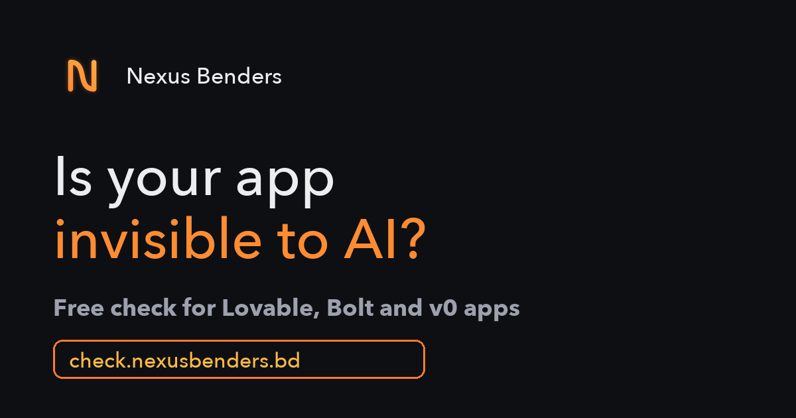

# Is your app invisible to AI?

A free checker for apps built with **Lovable, Bolt, v0** and other single-page-app builders.

**Live:** [check.nexusbenders.bd](https://check.nexusbenders.bd)



## Why

AI app builders produce single-page apps. The server sends a nearly empty HTML file, and JavaScript fills in the
page in the visitor's browser. People see the full site, but crawlers that don't run JavaScript, including most AI
assistants (ChatGPT, Perplexity, Claude) and link-preview bots (LinkedIn, Slack, WhatsApp), receive a blank page.
Google renders JavaScript too, but later and less reliably.

This tool fetches a page once, the way such a crawler would, and shows what it gets.

## What it checks

| Check | What it looks for |
|---|---|
| Content | Visible words in the raw HTML (score is capped at 35 if there are fewer than 30) |
| Title | Present and long enough to describe the product |
| Meta description | Present |
| Share image | `og:image` present, absolute, not Lovable's default, not hosted on a `*.lovable.app` preview |
| Share tags | `og:title`, `twitter:card` |
| robots.txt | Whether GPTBot, ClaudeBot, PerplexityBot and others are blocked from `/` |
| Sitemap | `/sitemap.xml` (urlset or sitemap index) or a `Sitemap:` line in robots.txt |
| Canonical | `<link rel="canonical">` |

It also detects the builder (Lovable, Bolt, v0, Replit, Base44) from markers in the HTML.

## How it works

- `src/analyze.js`: pure analysis of the raw HTML, with no network access, so it's easy to test or reuse.
- `src/worker.js`: a Cloudflare Worker. `POST /api/check` with `{ "url": "example.com" }` returns the JSON report.
  It only fetches public hostnames, caps responses at 2 MB and times out after 10 seconds.
- `public/`: the page, plain HTML with no build step, so crawlers can read it.

## Run it yourself

```bash
npm install
npx wrangler dev        # http://localhost:8787
npm test                # smoke test against a few live sites
```

To deploy to your own Cloudflare account, change or remove the `routes` custom domain in `wrangler.toml`, then:

```bash
npx wrangler login
npx wrangler deploy
```

Optional: create a KV namespace bound as `CHECKS` (see `wrangler.toml`) to log which hosts are checked.

## Limitations

- It checks the URL you give it (usually the homepage), not every route.
- It reads the raw HTML only. It doesn't render JavaScript, which is the point, but it also means it can't show
  what the page looks like after rendering.
- Workers can't fetch hostnames on their own Cloudflare zone, so a deployment can't check itself.

## Need it fixed?

The usual fix is prerendering your routes to static HTML and setting per-page meta and share tags, while you keep
building in Lovable. I do this as a fixed-price job: [check.nexusbenders.bd](https://check.nexusbenders.bd) or
nexusbenders@gmail.com.

## License

MIT © Nafiz Iqbal ([Nexus Benders](https://nexusbenders.bd))
